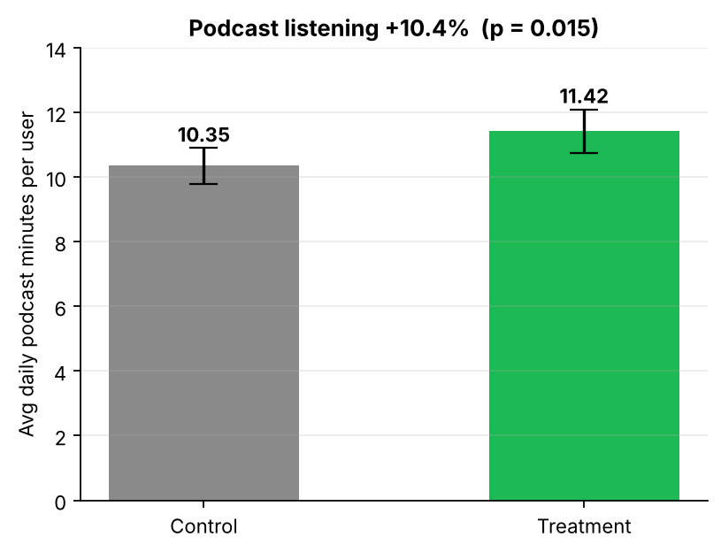
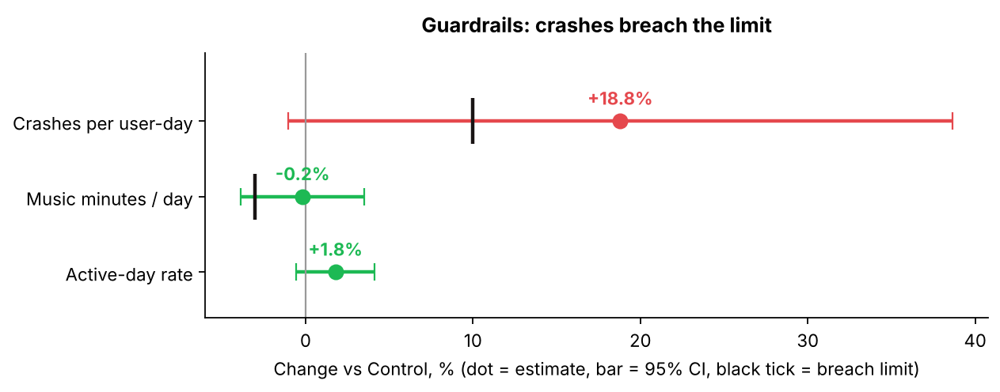
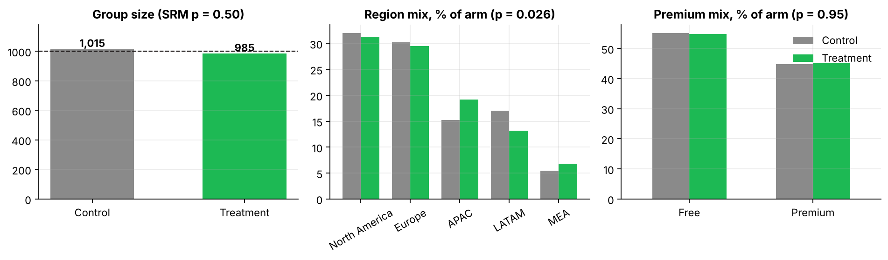
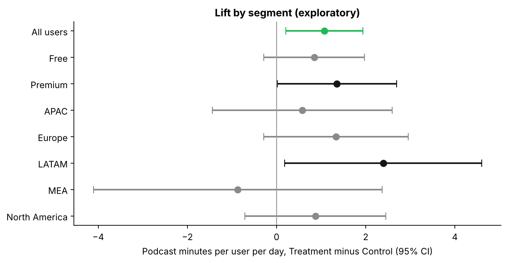
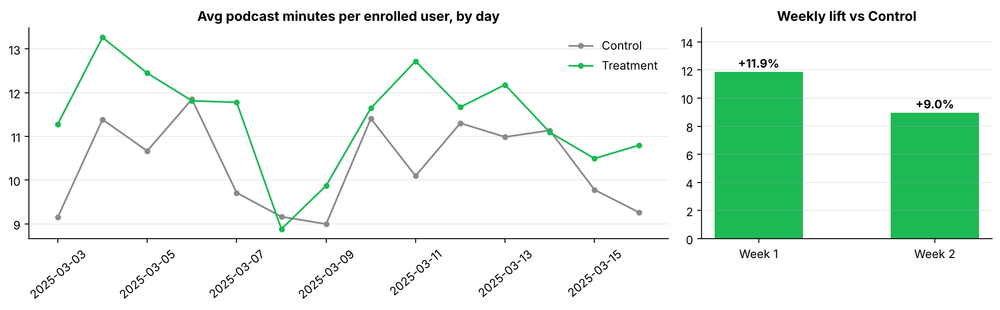

# Does a Video-First Discovery Feed Increase Podcast Listening?

An end-to-end A/B test analysis (SQL + Python) for a simulated Spotify experiment. It cleans messy data, validates randomization, tests statistical significance, checks app stability and music listening, and ends with a launch recommendation.

> **Recommendation: ITERATE.** The feed lifts podcast listening by about 10%, but it also increases app crashes beyond the agreed limit. Fix stability, then re-test.

## Key results

| Metric | Control | Treatment | Change | Result |
|---|---:|---:|---|---|
| **Podcast min / user / day (primary)** | 10.35 | 11.42 | **+10.4%** (95% CI +0.21 to +1.94) | **p = 0.015** |
| Discovery feed clicks / day | 0.69 | 0.99 | +43% | p < 0.0001 |
| Podcast listening days (of 14) | 6.72 | 6.99 | +4.0% | p = 0.009 |
| **Crashes per user-day (guardrail)** | 0.0161 | 0.0191 | **+18.8%** | **Breached** (limit +10%) |
| Music min / user / day (guardrail) | 38.54 | 38.47 | -0.2% | Pass |

<p align="center">
  
  
</p>

## Project question and design

- **Hypothesis:** H0: mean daily podcast minutes per user is the same in Control and Treatment. H1: it differs.
- **Design:** 2,000 users, 50/50 user-level randomization (1,015 / 985), 14 days (3 to 16 Mar 2025), intent-to-treat, two-sided alpha = 0.05.
- **Primary metric:** average daily podcast minutes per user. **Secondary:** feed clicks, listening days, active-day rate (Bonferroni alpha 0.0125). **Guardrails:** crashes, music minutes, active days, Premium cancellations.
- **Decision rule:** ship / iterate / do not ship, based on the primary metric and the guardrails together.

## What I did

1. **Audited and cleaned the data.** Removed 78 duplicates, 20 orphan IDs and 12 impossible values (110 of 19,741 rows), standardized 47 messy Region labels, and reconciled row counts at every step. See [`cleaning_log.md`](cleaning_log.md).
2. **Validated randomization before looking at results.** No sample ratio mismatch (p = 0.50). Balanced on Premium and account age. A mild Region imbalance (p = 0.026) was checked with an adjusted model, and the result did not change.
3. **Built a user-level table in SQL** (one row per user, inactive days as zeros) to avoid treating repeated daily rows as independent.
4. **Tested significance.** Welch t-test with CI, plus Mann-Whitney and bootstrap as robustness checks. Bonferroni correction for secondary metrics, one-sided tests for guardrails.
5. **Checked stability, music and novelty.** Crashes breach the limit, music is flat, and the lift fades slightly from week 1 (+11.9%) to week 2 (+9.0%).
6. **Quantified power.** The test could only detect about a 10.8% lift, so the observed effect is probably overstated.

<p align="center">
  
</p>
<p align="center">
  
  
</p>

## Limitations (stated up front)

- **Premium cancellation could not be evaluated.** The data has no cancellation events.
- **The crash estimate is imprecise.** Crashes are rare, so the 95% CI is wide (about -1% to +39%), but the estimate and the one-sided test both breach the rule.
- **The primary result is fragile.** A rank-based test gave p = 0.058, and the effect is likely overstated.
- **Segment results are exploratory** (Premium +13%, LATAM +25%, MEA -8%) and do not survive multiple-testing correction.

## Repository contents

| File | What it is |
|---|---|
| [`cleaning_log.md`](cleaning_log.md) | Cleaning log and data-quality summary with row reconciliation |
| [`analysis.sql`](analysis.sql) | Commented SQL: audit, cleaning views, user-level metrics, segments, daily trend |
| [`analysis.ipynb`](analysis.ipynb) | Full analysis notebook: SRM, balance, t-tests, guardrails, power, charts |
| [`executive_summary.pdf`](executive_summary.pdf) | One-page summary with the Ship / Iterate / Do Not Ship recommendation |
| `data/` | The two simulated CSV files |
| `images/` | Charts used in this README |

## How to run

```bash
git clone https://github.com/<your-username>/spotify-podcast-video-ab-test.git
cd spotify-podcast-video-ab-test
pip install -r requirements.txt
jupyter notebook analysis.ipynb      # Kernel > Restart & Run All
```

The notebook loads the CSVs from `data/` into an in-memory SQLite database. To run the SQL on its own, import both CSVs into SQLite (for example with DB Browser for SQLite) using the table names `users_experiment_map` and `daily_user_activity`, then execute `analysis.sql`.

## Tools

Python (pandas, NumPy, SciPy, Matplotlib), SQL (SQLite, CTEs, window functions, views), Jupyter.

## Author

**Amit Verma**, Data Analytics. The data is simulated for learning and portfolio purposes.
